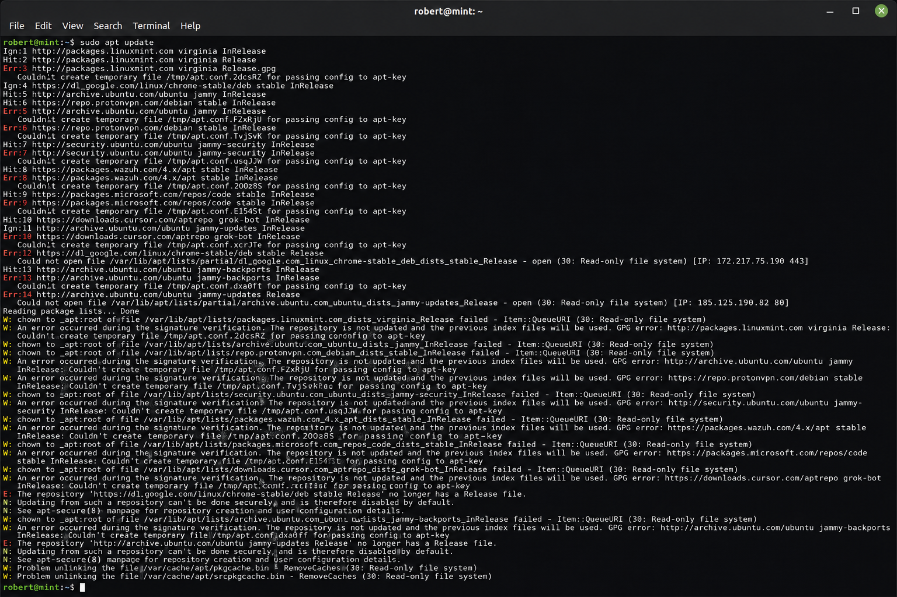
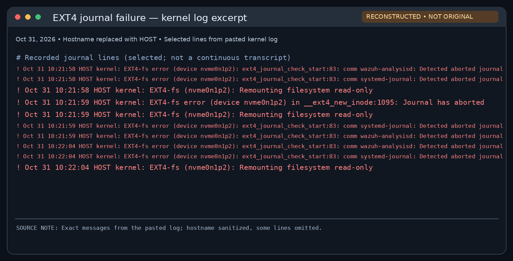
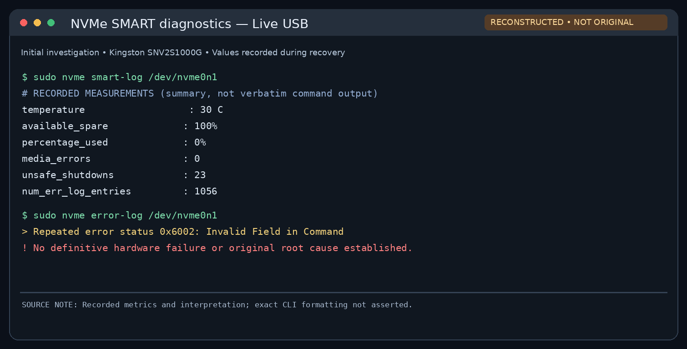
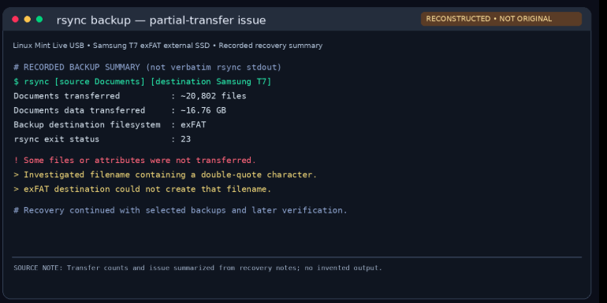
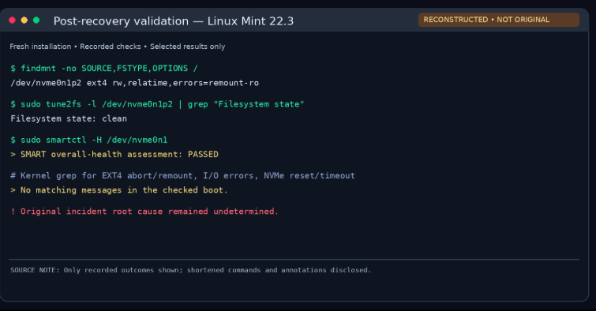

# linux-mint-disaster-recovery
Hands-on Linux Mint disaster recovery project documenting EXT4 filesystem failure, NVMe diagnostics, data backup, OS reinstallation, and system restoration.
# Linux Mint Disaster Recovery and System Restoration

## Project Overview

This project documents a hands-on Linux disaster recovery experience involving an EXT4 filesystem failure on a Linux Mint workstation.

The incident began when APT package management operations failed because the filesystem had become read-only. Further investigation revealed EXT4 journal errors and a protective read-only remount.

To recover the system, I used a Linux Mint Live USB to investigate the NVMe SSD, preserve important files and application configurations, and prepare for a fresh operating system installation.

After installing Linux Mint 22.3, I restored my development environment, verified personal files, reinstalled security tools, and tested system functionality.

## Project Objectives

- Investigate Linux filesystem and package management errors.
- Identify the cause of read-only filesystem behavior.
- Preserve important files and configurations before reinstalling Linux.
- Verify backup integrity using checksums.
- Restore essential applications and development tools.
- Implement automated malware scanning using ClamAV and systemd.
- Validate filesystem and SSD health after recovery.
- Document troubleshooting procedures, results, and lessons learned.

## Technologies and Tools

**Operating Systems:** Linux Mint 21.3, Linux Mint 22.3, Linux Mint Live USB

**Linux Utilities:** Bash, APT, journalctl, findmnt, rsync, smartctl, nvme-cli, tune2fs, systemd

**Backup and Security:** Samsung T7 external SSD, SHA-256, GPG encryption, ClamAV

**Restored Applications:** Anaconda, Python, Jupyter, Spyder, Visual Studio Code, Ollama, Bitwarden, Cisco Packet Tracer

## Recovery Outcome

The workstation was successfully rebuilt with Linux Mint 22.3.

Important personal files and development projects were restored, and essential applications were reinstalled and tested.

Post-recovery diagnostics confirmed that the EXT4 filesystem was clean and mounted read-write. The NVMe SSD passed its SMART overall-health assessment and reported zero media and data integrity errors.

The SSD continued to report NVMe invalid-command errors, so the original failure's underlying cause remains unconfirmed.

ClamAV malware detection and automated daily scanning were also successfully tested.

**Project scope:** Wazuh SIEM restoration is deferred to a separate project.

## Recovery Screenshots

The following images document the investigation and recovery process, from the initial APT errors to successful system restoration.

**Evidence note:** Some terminal-style images are illustrative reconstructions based on recorded troubleshooting results, not original terminal captures. The original command outputs and technical findings should be treated as the authoritative evidence.

### 1. Initial APT Errors



Figure 1 — Reconstructed APT terminal output based on recorded troubleshooting logs. The repeated temporary-file failures and read-only filesystem errors indicated a filesystem-level problem rather than an ordinary package dependency issue. This is not an original terminal capture.

### 2. EXT4 Filesystem Investigation



Figure 2 — Reconstructed EXT4 kernel log excerpt based on recorded messages from October 31, 2026. The logs show an aborted journal and repeated read-only remounts of the root filesystem. This is not an original terminal capture.
### 3. Linux Mint Live USB Preparation

After identifying the EXT4 filesystem failure, I prepared a bootable Linux Mint 22.3 Cinnamon USB drive using Rufus on a separate Windows 11 computer.

**Recovery environment:**

- **Operating system:** Linux Mint 22.3 Cinnamon (Zena)
- **USB drive:** 8 GB
- **USB creation tool:** Rufus
- **Persistence:** Disabled (0 GB)
- **Purpose:** Boot into an independent Linux environment without relying on the affected internal operating system.

Initially, the USB drive was not detected during the boot process. After reseating the drive, the system recognized it and successfully booted into the Linux Mint Live environment.

From the Live session, I was able to access the Kingston NVMe SSD, identify the Samsung T7 external backup drive, and begin filesystem diagnostics and data recovery.

*Note: The original Rufus preparation screenshot was not retained. This section is based on recorded troubleshooting steps.*

### 4. Storage Device Identification

During the Linux Mint Live USB recovery, I used Linux storage utilities to identify the internal NVMe SSD, recovery USB, and external backup drive.

The following is a simplified summary of the recorded storage layout, not verbatim terminal output.

```text
sda              7.5G    Linux Mint Live USB
sdb            931.5G    Samsung T7 external SSD (exFAT)
nvme0n1        931.5G    Kingston NVMe SSD
├─nvme0n1p1      512M    FAT32 EFI system partition
└─nvme0n1p2      931G    EXT4 Linux root partition
```

The Kingston NVMe SSD contained the affected Linux installation, while the Samsung T7 was used to preserve important files and application configurations.

Identifying each device before performing backup operations helped reduce the risk of accidentally modifying the wrong storage device.

### 5. NVMe SSD Diagnostics


*Figure 5 — Reconstructed NVMe SMART diagnostic summary based on measurements recorded during the Linux Mint Live USB recovery. The SSD reported zero media errors and 1,056 NVMe error-log entries. These findings did not establish a definitive hardware failure or root cause.*

SMART and NVMe diagnostics were used to investigate the internal SSD.

### 6. Data Backup and Recovery Using rsync

After booting into the Linux Mint Live USB environment, I connected a Samsung T7 external SSD to preserve important files before reinstalling Linux Mint.

I used `rsync` to transfer data from the affected Kingston NVMe SSD to the external drive.

**Recorded backup results:**

| Metric | Result |
|---|---|
| Source | Kingston NVMe SSD |
| Destination | Samsung T7 external SSD (exFAT) |
| Files processed | Approximately 20,802 |
| Data transferred | Approximately 16.76 GB |
| rsync exit code | 23 — Partial transfer |

**Troubleshooting the backup error**

During the backup, `rsync` returned exit code 23, indicating that some files or attributes were not transferred successfully.

The investigation identified a filename containing a double quotation mark (`"`) that could not be created on the exFAT destination filesystem.

This was a destination filesystem compatibility issue rather than evidence that the entire backup had failed.

**Recovery outcome**

The majority of the Documents backup was transferred successfully. The partial-transfer error was documented, and important recovered files were subsequently restored and verified.

Sensitive application data, including credential-related files, was handled separately from the ordinary Documents backup.

**Lesson learned:** A successful backup requires checking both the transfer summary and any reported errors. An `rsync` exit code of 23 should be investigated rather than ignored.

### 7. Backup Investigation



Figure 7 — Reconstructed summary of the rsync backup investigation. Approximately 20,802 files (16.76 GB) were transferred to the Samsung T7. Exit code 23 indicated a partial transfer, with an exFAT-incompatible filename identified during troubleshooting. This is not an original terminal capture.

### 8. Post-Recovery Validation



Post-recovery checks confirmed a clean EXT4 filesystem, read-write access, and a passing SMART health assessment

## Technical Documentation

For detailed troubleshooting procedures, findings, and lessons learned:

- [Incident Timeline](documentation/incident-timeline.md)
- [Backup and Recovery](documentation/backup-and-recovery.md)
- [System Restoration](documentation/system-restoration.md)
- [Lessons Learned](documentation/lessons-learned.md)
